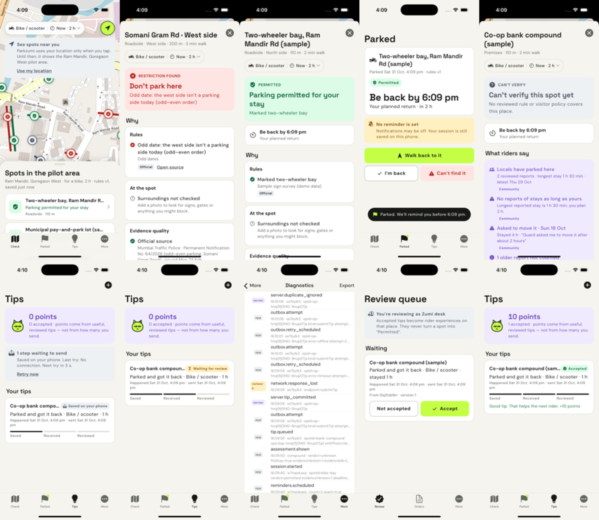
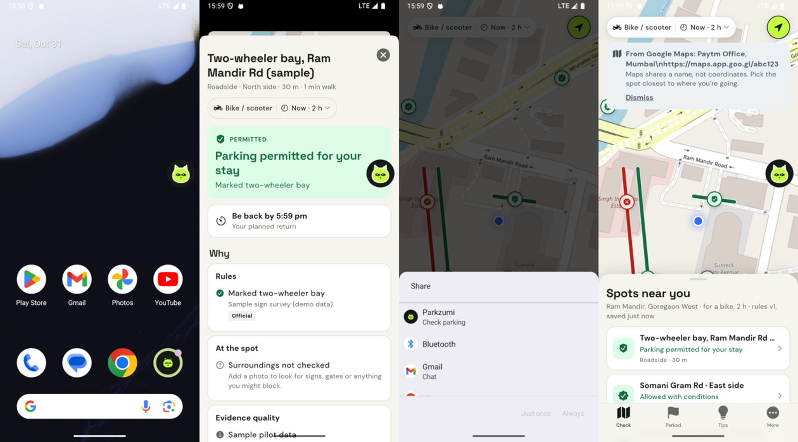

# parkzumi — Know the spot.

A Mumbai parking companion for riders who are tired of getting towed. Point it at the exact spot where
you want to leave your bike, say how long you'll stay, and it tells you — with sources — whether that
works, what the conditions are, what other riders actually experienced, and what is still unknown.
Then it remembers where you parked and reminds you before you need to move.

Built for **MAL 04 — Architects in AI Era** (Proptech track), 1 Nov 2026, Paytm Mumbai.
Flutter app for Android and iOS, with an iOS look and feel on both.

> **The rule we defend:** only reviewed official or operator evidence covering your whole stay can make a
> spot *Permitted*. Community tips (reviewed first) and AI photo readings can add concerns — never permission.

## The journey

1. **Check** — the pilot area on a map, every kerb and compound judged for *your* vehicle, arrival time
   and stay. Tap a spot: verdict, reasons per dimension, official source link, conditions, "be back by",
   what we don't know, better options nearby.
2. **No sign? Photo check** — mark where you'd park; Gemini 4 Argon reports signs, gates and entrances
   near that spot as structured observations. It can raise a doubt, never grant permission.
3. **Park here** — a durable session with reminders timed for your walk back; if a temporary order is
   published later, the deadline and reminders move and you're told why.
4. **Share a tip** — what happened, when (not when you sent it), for which vehicle and stay. Saved on the
   phone first, delivered exactly once, reviewed by a second role, rewarded once.
5. **Can't find it** — your saved context and official channels, with "can't find it", "think it was
   towed" and "confirmed towed" kept distinct.
6. **Android companion** — a floating Zumi bubble over apps like Google Maps opens straight into "check
   where I am"; you can also *Share* a place from Google Maps to Parkzumi.

## Screens

The automated journey on the iOS simulator — check → restriction → permitted → parked → rider
experiences → tip saved on the phone → received after a lost reply → diagnostics trail → review → accepted:



Android companion — floating Zumi over other apps → straight into the nearest spot → "Share" from
Google Maps → the shared destination (name only):



## Run it

Requires Flutter 3.47+ (Dart 3.13), Xcode 26 for iOS or the Android SDK for Android.

```bash
flutter pub get
flutter run                                         # pick an iOS simulator or Android emulator
```

To enable the photo check (Gemini 4 Argon), copy `config/dart_defines.example.json` to
`config/dart_defines.json` (git-ignored), add your key, and run
`flutter run --dart-define-from-file=config/dart_defines.json`. Without a key the app says the photo check
isn't switched on and everything else works.

Put the simulator in the pilot area (Ram Mandir, Goregaon West):

```bash
xcrun simctl location booted set 19.15105,72.84650         # iOS
adb emu geo fix 72.84650 19.15105                           # Android emulator
```

Without location the app still works: pick a spot from the list. Drift code is generated and committed;
after changing tables run `dart run build_runner build --delete-conflicting-outputs`.

### Performance monitoring (Measure SDK, optional)

The Measure SDK (measure.sh) is integrated and switches on only with credentials — without them the app
keeps its own local diagnostics. Every timed diagnostic event (time to answer a spot, photo-check latency,
tip delivery, time to first frame) becomes a Measure span; other events appear on the session timeline.

1. Create an Android app and an iOS app in the Measure dashboard.
2. Android: add `measure.apiKey=…` and `measure.apiUrl=…` to `android/local.properties` (git-ignored).
3. iOS: copy `ios/Flutter/Secrets.example.xcconfig` to `ios/Flutter/Secrets.xcconfig` (git-ignored) and fill it in.
4. Set `"MEASURE_ENABLED": "true"` in `config/dart_defines.json` and run with `--dart-define-from-file`.

The first iOS build fetches the Measure iOS SDK over Swift Package Manager, which takes a few minutes.

## Test

```bash
flutter test                       # 50 tests: engine rules, recovery on real SQLite files, sessions, AI validation
scripts/journey.sh <device-id>     # full journey on a simulator/emulator, screenshots in build/shots
```

The journey has passed on the iOS Simulator (iPhone 16 Pro, iOS 26) and the Android emulator (API 36).

## Demo and failure injection

**More › Diagnostics & failure demo** lets you go offline, fail requests with 503, **lose the reply to the
next tip** (the server saves it, the phone never hears back), slow the network, and break the photo check.
The event trail there shows what happened and exports as JSON. Step-by-step: [`docs/demo-script.md`](docs/demo-script.md).

## Architecture

* [`docs/architecture.md`](docs/architecture.md) — framing, diagram, sources of truth, state machines,
  failure table, trade-offs, a future requirement, tests and observability.
* Decision records: [deterministic engine](docs/adr/0001-deterministic-engine-decides.md) ·
  [local outbox with operation ids](docs/adr/0002-local-outbox-idempotent-operations.md) ·
  [Android companion](docs/adr/0003-android-companion-entry.md).

```
lib/domain     pure Dart: models, IST schedules, assessment engine (the business rule)
lib/data       device DB, outbox sync, sessions, tips, simulated server (own DB file)
lib/ai         Gemini photo interpreter with validation and typed failures
lib/platform   location, reminders, Android companion channel
lib/app        composition root, providers, theme tokens
lib/ui         Cupertino-style screens
```

## What is real, sample and simulated

| Real | Sample (labelled in the app) | Simulated |
|---|---|---|
| Mumbai Traffic Police Permanent Notification No. 64/2026 — odd–even parking on Somani Gram Road (Vishal Sweets → Rajnigandha Building), checked 31 Oct 2026 | Every other place, policy, price and rider report; invented names, so no made-up rule is attached to a real business | The server: runs in the app with its own SQLite file. Idempotency, review, versioning and rewards are real logic; transport, sign-in and multi-device access are not |

Road geometry is approximate (OSM has no named geometry for Somani Gram Road). Map tiles come from the
public OpenStreetMap tile server — fine for a demo, to be replaced before release.

**This prototype cannot guarantee** that a vehicle won't be towed, live space availability, current
accuracy of sample data, or on-time delivery of reminders (scheduling is local; delivery is up to the OS).

## Credits

Space Grotesk and DM Sans (SIL Open Font License, `assets/fonts/OFL-*.txt`). Map data © OpenStreetMap
contributors (ODbL). Parkzumi and Zumi are working names for this prototype.
