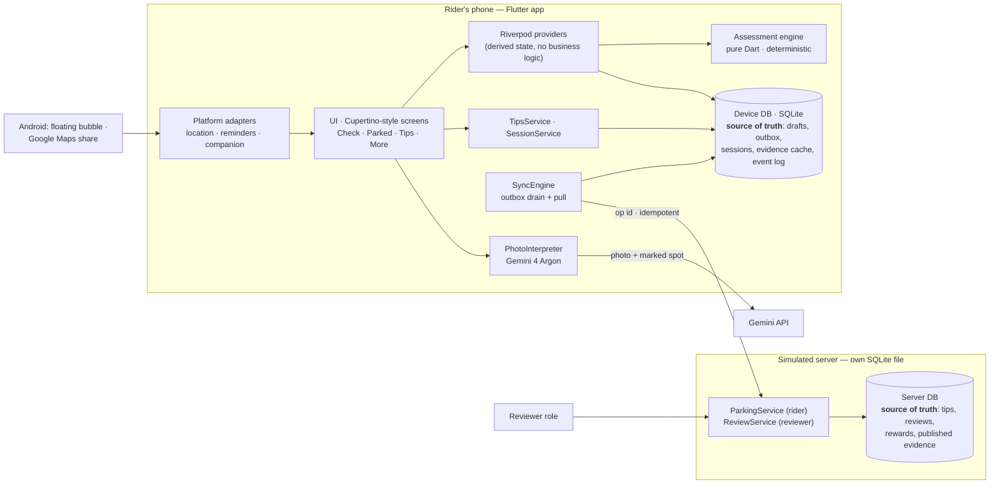

# Parkzumi — architecture

Track: **Proptech — reliable Mumbai parking and property-access information.**
Prototype for MAL 04 (1 Nov 2026). Everything below matches the code in this repository.

## 1. Problem framing and scope

A two-wheeler rider in Mumbai has to decide, at the moment they leave the vehicle, whether **this exact
spot works for this vehicle for the whole planned stay** — often with no sign in sight. The founder has
been towed about five times. A map of "parking" doesn't answer that; the answer depends on the road side,
the date (odd–even orders), the time window, the property's visitor policy, and what other riders have
actually experienced.

| | In this prototype | Deliberately out |
|---|---|---|
| Area | One pilot neighbourhood: Ram Mandir, Goregaon West (12 places) | Citywide coverage |
| Answer | Deterministic verdict + six separate dimensions + unknowns | Towing probabilities, a single "safety score" |
| Data | 1 real order (MTP Notification No. 64/2026, odd–even on Somani Gram Road) + labelled sample data | Live occupancy, scraped Google data |
| Community | Tips with event time ≠ submit time, review before use, points on acceptance | Automatic trust from volume |
| After parking | Durable session, reminders, mid-session rule changes, missing-vehicle help | Payments, booking, towing-yard APIs |
| Entry points | Android floating companion bubble, "Share" from Google Maps | Reading the Maps screen |

**Success looks like:** no spot is ever shown as *Permitted* without reviewed evidence covering the whole
stay (enforced in code, tested); every answer shows its reason, source class, freshness and what's unknown;
a tip is never lost or duplicated, whatever the network does; a parking session survives the app being killed.

## 2. The business rule

> **Only reviewed evidence decides.** A spot is **Permitted** only when a reviewed official or operator
> source permits this vehicle for every minute of the planned stay. Community tips must be reviewed before
> anyone sees them, and even then they are shown as *experiences*, never as permission. An AI photo reading
> can add a doubt — never grant permission.

Where it is enforced:

| Rule part | Enforcement | Test |
|---|---|---|
| Reviewed official/operator evidence only | `AssessmentEngine.evaluate` ignores pending rules, counts a *permission* only from an official/operator source (`_canPermit`), and records without a review status deserialise as pending; community observations never enter the verdict path | `engine_test.dart` › *business rule* group |
| Whole stay, this vehicle | Stay split at every schedule/effective-date boundary; each segment probed (`Schedule.boundaries`) | *the whole stay is checked* group, *crossing midnight* test |
| Tips reviewed first | Server only adds an observation to evidence inside `reviewTip(accept: true)` | `recovery_test.dart` |
| AI can't permit | Restrictive sign ⇒ downgrade to *Can't verify*; a "parking allowed" sign changes nothing | *AI photo observations* group |
| Review once | Tip state machine `received → accepted/rejected`; second review ⇒ `StaleVersion` (409) | *lost acknowledgement* test |

The rider sees the rule as a clear rejection: "Can't verify this spot yet — we have no reviewed rule for
this side of the road", with community experiences shown separately in purple.

## 3. Structure and boundaries

Dependency rule: `lib/domain` (pure Dart, no Flutter) ← `lib/data` ← `lib/app` ← `lib/ui`;
`lib/platform` holds OS adapters behind small interfaces (`ReminderScheduler`, `LocationService`,
`CompanionChannel`). The app reaches the server **only** through `ParkingService` / `ReviewService`, with
JSON-shaped DTOs, so an HTTP client can replace `SimulatedServer` without touching the rest.

| Module | Responsibility | Key files |
|---|---|---|
| Domain | Spots, rules, schedules (IST, odd–even), policies, observations, assessment, ranking | `lib/domain/engine.dart`, `schedule.dart`, `models.dart` |
| Evidence | Cached copy of published evidence with its age | `lib/data/evidence_repository.dart` |
| Contributions | Tip drafts + outbox ops written in one transaction | `lib/data/tips_service.dart` |
| Sync | Deliver ops with stable ids, backoff, dependency order; pull evidence and tip states | `lib/data/sync_engine.dart` |
| Sessions | Active session, reminders, re-check when evidence changes, missing states | `lib/data/session_service.dart` |
| Server (simulated) | Idempotency, tip state machine, version checks, rewards, evidence versions, audit | `lib/data/server/simulated_server.dart` |
| AI | Structured observations, validation, typed failures | `lib/ai/photo_interpreter.dart` |
| Android companion | Overlay bubble service, Maps share intake | `android/.../CompanionService.kt`, `MainActivity.kt` |
| Observability | Structured event log, export | `lib/data/event_logger.dart`, `lib/ui/diagnostics_screen.dart` |

## 4. Data and state

### Sources of truth

| Fact | Owner | Other copies | Freshness shown |
|---|---|---|---|
| Rules, policies, reviewed observations (evidence) | Server (`srv_evidence`, versioned) | Device `evidence_cache` | "rules v3 · saved 5 min ago"; > 24 h ⇒ caution |
| Tip before the server acknowledges it | Device (`tips` + `outbox_ops`) | — | "Saved on your phone" |
| Tip after acknowledgement, review, reward | Server (`srv_tips`, `srv_rewards`) | Device mirror updated by pull | status timeline |
| Parking session | Device (`sessions`) | — | — |
| Reminders | OS scheduler, derived from the session | — | reconciled at every launch |
| An assessment | Computed on device; logged with inputs + evidence version (`assessment_log`, events) | — | "checked 3:41 pm" |
| Photo observations | AI — **not a source of authority** | attached to one check only | labelled "AI · unverified" |

### State machines

* **Tip:** `queued` (on phone) → `sending` → `received` (server) → `accepted` | `rejected`; or `failed`
  (permanent validation error). Only the server moves past `received`; reviewing an already-reviewed tip is
  refused (explicit reopening would be a separate action).
* **Outbox op:** `pending → inFlight → done` | `failed`; `inFlight` left by a crash becomes `pending` at launch.
* **Session:** `active → ended`; `active → missing(searching | reportedTowed | confirmedTowed | theftReported)`;
  `found` returns to `active`. "Reported towed" and "confirmed towed" are never merged.
* **Evidence:** a monotonically increasing version. Accepting a tip, publishing or withdrawing a temporary
  order creates a new version; clients pull it and active sessions are re-checked.

Time: all rules are evaluated in Asia/Kolkata (fixed UTC+05:30, no DST) — `lib/domain/time_ist.dart`.
Unknown prices stay unknown (never ₹0); absence of a sign is never permission.

## 5. Failure and recovery

| Failure | Behaviour | Demo | Test |
|---|---|---|---|
| **Server saved the tip, reply lost, app killed** | Op keeps its id; on relaunch `recoverInterrupted` + retry ⇒ server returns the stored result (`server.duplicate_ignored`) ⇒ one tip, one reward | Diagnostics › *Lose the reply to the next tip* → share a tip → kill app → reopen | `recovery_test.dart` (file DBs closed/reopened), `journey_test.dart` |
| Offline / 503 | Tip stays "Saved on your phone"; retry with backoff 2–60 s | Diagnostics › Online off / *Next 2 requests fail* | *offline* test |
| Photo upload fails | Tip op waits for its photo op (`dependsOn`); no half-submitted report | 503 toggle with a photo tip | *waits for its photo* test |
| Invalid tip | Rejected for good with the reason; not retried | — | *invalid tip* test |
| Stale review | Version check ⇒ "Already reviewed by …" | Accept the same tip twice | *lost acknowledgement* test |
| Rules change mid-session | Evidence v+1 ⇒ `SessionService.recheck` moves the deadline (to *now* if an order is already in force), reschedules reminders, alerts and shows "Conditions changed"; a withdrawn order restores the plan | Reviewer › Orders › publish, then withdraw, an order on the spot you parked | `session_test.dart` |
| App killed while parked | Session restored; reminders reconciled — none duplicated, orphans cancelled | Park, kill, reopen | `session_test.dart` |
| Location off / inaccurate | Rider picks the spot; never auto-picks a road side; accuracy shown | Deny location | engine *evidence quality* tests |
| AI timeout / malformed / blocked | Typed error, rest of the answer unchanged | Diagnostics › AI toggles | `photo_interpreter_test.dart` |
| Reminder can't be exact | Shown honestly: "may arrive a few minutes late"; scheduling ≠ delivery | Android 14 default | — |
| Companion permission missing | Explains, opens settings; normal launch still works | Turn bubble on without permission | — |

## 6. Trade-offs and adaptability

| Decision | Chosen | Alternative | Why / consequence |
|---|---|---|---|
| Who decides | Deterministic engine (ADR 0001) | LLM judges photo + location | Explainable, testable, can't hallucinate permission; coverage limited to curated evidence ⇒ many honest "Can't verify" |
| Writes | Local outbox + idempotent op ids (ADR 0002) | Direct calls with UI retry | Survives offline/kill without duplicates; eventual consistency |
| Backend | Simulated in-app server, own DB file | Supabase now | Demo independent of venue Wi-Fi; transport/auth simulated (stated in the app) |
| Evidence storage | Latest snapshot as one JSON document + an audit row for every change | Normalised PostGIS tables | Fine for 12 places; replace with bbox queries when coverage grows |
| Companion | User-toggled overlay bubble + Maps share (ADR 0003) | Detect Maps in foreground / Accessibility | No screen reading; not auto-shown only over Maps |
| Sessions | One active per device | Multiple vehicles | Simpler reminders; a household feature later |

**A realistic next requirement — "warn riders already parked when a temporary order is published":**
today the warning arrives on the next sync (≤ 30 s while the app is open). To make it real-time we would add
a push channel (FCM/APNs) that only *triggers* `SyncEngine.sync()`. What changes: a push adapter in
`lib/platform`, a server fan-out to sessions near the spot (needs server-side sessions — today they are
device-only by design), and delivery state per alert ("queued ≠ warned"). What doesn't change: the engine,
evidence versioning and `SessionService.recheck`, which already move the deadline and reminders.

## 7. Testing and observability

* `test/domain/engine_test.dart` — 29 rule tests (odd–even, midnight, gate hours, max stay, vehicle,
  temporary/expired/pending orders, community never permits — even a "reviewed" community permit —,
  records without a review status fail closed, AI limits, staleness, JSON round trip).
* `test/data/recovery_test.dart` — lost reply + kill, in-flight crash, offline, "Retry now" skips backoff,
  photo dependency, invalid tip, review rules — on real SQLite files closed and reopened.
* `test/data/session_test.dart` — session survives kill, reminder reconciliation, mid-session order
  (future, already in force, withdrawn), missing → found restores reminders.
* `test/ai/photo_interpreter_test.dart` — schema validation, injection text, wrong-shaped answers,
  timeout, 429/500, blocked.
* `integration_test/journey_test.dart` — the full journey on a simulator/device with screenshots.

Every step writes a structured event (`lib/data/event_logger.dart`): `assessment.shown` (verdict, evidence
version and ids, inputs), `outbox.attempt/acked/retry_scheduled/rejected`, `server.tip_committed /
duplicate_ignored`, `network.response_lost`, `session.started/conditions_changed`, `reminders.reconciled`,
`ai.request/response/failed`. Diagnostics shows the trail, filters by correlation id and exports JSON.
The same events are forwarded to the Measure SDK when it is configured (`lib/app/measure_bridge.dart`):
events with a duration become spans, the rest custom events — so production performance (launch, time to
answer, photo-check latency, tip delivery) is visible without adding instrumentation to domain code.
No photos, notes or exact coordinates are logged. A real trail of the lost-reply recovery, captured from
the journey run: [`docs/evidence/lost-reply-trail.txt`](evidence/lost-reply-trail.txt).
